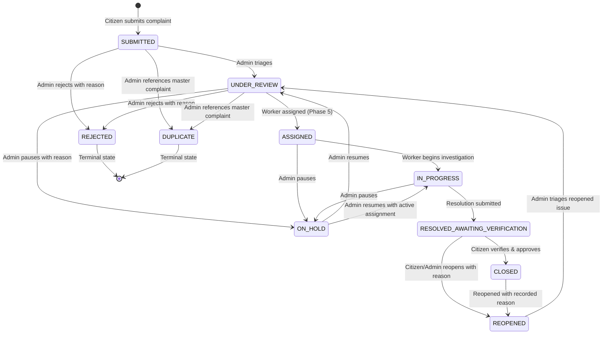

# CivicPulse — Backend Architecture

## Overview

CivicPulse uses a layered, modular backend architecture built with Python and FastAPI. Each layer has a clear responsibility and communicates only with adjacent layers, ensuring separation of concerns and testability.

## Architectural Layers

```
┌─────────────────────────────────────────────────┐
│                   API Layer                      │
│       (FastAPI route handlers + schemas)         │
├─────────────────────────────────────────────────┤
│                Service Layer                     │
│         (Business logic + orchestration)         │
├─────────────────────────────────────────────────┤
│                 Data Layer                       │
│     (SQLAlchemy ORM models + DB sessions)        │
├─────────────────────────────────────────────────┤
│               Core / Cross-cutting               │
│  (Security, Exceptions, Constants, Middleware)   │
└─────────────────────────────────────────────────┘
```

### API Layer (`app/api/`)

- Defines HTTP endpoints using FastAPI routers (`app/api/v1/auth.py`, `app/api/v1/complaints.py`, `app/api/v1/categories.py`, `app/api/v1/departments.py`, `app/api/v1/workers.py`, `app/api/v1/assignments.py`, `app/api/v1/router.py`).
- Handles request parsing, response serialisation, and HTTP status codes.
- Enforces authentication and authorization dependencies (`app/api/deps.py`):
  - `get_current_user`: Bearer JWT token extraction, decoding, and live DB user verification.
  - `get_current_active_user`: Enforces account active flag.
  - `require_roles`, `require_citizen`, `require_admin`, `require_worker`: Declarative RBAC role guards.
- Scopes data retrieval to prevent Insecure Direct Object References (IDOR):
  - Citizens can query only their authored complaints.
  - Field Workers access tasks strictly through `/api/v1/workers/me/tasks`, preventing unauthorized cross-worker task inspection.
  - Administrators maintain comprehensive oversight across all complaints, departments, workers, and assignments.
- Delegates all business logic to the service layer.
- Never directly accesses the database — always goes through services or dependency injection.
- Uses Pydantic schemas (`app/schemas/`) for input validation and output formatting.

### Service Layer (`app/services/`)

- Contains all business logic and domain rules.
- `app/services/auth_service.py`: User registration (with role assignment to CITIZEN), credential authentication with timing-attack mitigation, and JWT token issuance.
- `app/services/category_service.py`: Category and municipal department idempotent seeding and active category retrieval.
- `app/services/department_service.py`: Department lifecycle management, unique code/name validation, and assignment-safe soft-deactivation.
- `app/services/worker_service.py`: Atomic user and worker profile provisioning (role `FIELD_WORKER`), profile management, and account deactivation.
- `app/services/assignment_service.py`:
  - Department-matched complaint assignment to available field technicians.
  - Worker task acceptance, work commencement (`IN_PROGRESS`), and immutable milestone logging.
  - Work completion transitioning complaint to `RESOLVED_AWAITING_VERIFICATION`.
  - Concurrency-safe reassignment with reason capture, preserving previous assignments in `REASSIGNED` state.
- `app/services/complaint_service.py`:
  - Complaint submission with server-side trusted defaults (`SUBMITTED`, `MEDIUM`).
  - Sequence-driven tracking code generation (`CP-YYYY-XXXXX`).
  - Centralized lifecycle state transition engine with PostgreSQL row-level locking (`with_for_update`).
  - Strict enforcement of the complaint transition matrix, preventing arbitrary state changes, terminal state mutations, or self-approvals.
  - Administrative triage, priority adjustments with recorded reasons, and duplicate resolution validation.
  - Atomic insertion of `ComplaintStatusHistory` audit records in the same transaction as state changes.
- Receives a database session via dependency injection.
- Raises domain exceptions (`app/core/exceptions.py`), never HTTPException.
- Returns domain objects; the API layer converts them to response schemas.

### Data Layer (`app/models/`, `app/db/`)

- SQLAlchemy 2.0 ORM models define the relational schema:
  `roles`, `users`, `departments`, `categories`, `workers`, `locations`, `complaints`,
  `assignments`, `assignment_progress`, `attachments`, `complaint_status_history`, `notifications`, `feedback`, `ai_assessments`.
- `assignments` includes `accepted_at`, `started_at`, and partial unique index `uq_active_assignment_per_complaint` enforcing at database level that no complaint has more than one active technician.
- `assignment_progress` captures immutable timestamped milestone updates for work performed.
- `app/db/session.py` manages the engine, session factory, and the `get_db` dependency.
- `app/db/base.py` provides the declarative base class and `TimestampMixin`.
- Alembic manages schema migrations in the `alembic/` directory, resolving database URLs
  dynamically from application settings via `app.config.get_settings()`.

### Core Layer (`app/core/`)

- **security.py** — Password hashing (bcrypt), JWT creation and validation.
- **admin_provision.py** — Offline administrative user provisioning CLI utility.
- **exceptions.py** — Domain exception hierarchy mapped to HTTP status codes.
- **constants.py** — Enumerations (roles, complaint statuses, priorities).
- **middleware.py** — Request logging, rate limiting (future).

## Design Principles

### 1. Separation of Concerns
Each module has a single responsibility. Route handlers do not contain business logic. Services do not know about HTTP status codes.

### 2. Dependency Injection
FastAPI's `Depends()` mechanism provides database sessions, authentication context, and configuration to route handlers and services without global state.

### 3. Domain Exception Pattern
Services raise domain-specific exceptions (e.g., `EntityNotFoundError`, `InvalidStateTransitionError`). Global exception handlers in `main.py` translate these to appropriate HTTP responses. This keeps the service layer framework-agnostic and testable.

### 4. Configuration via Environment
All configuration is loaded from environment variables using `pydantic-settings`. No secrets are hardcoded. The `.env` file is gitignored.

### 5. Complaint Lifecycle State Machine
Complaint status transitions are strictly validated by a centralized state machine service (`app/services/complaint_service.py`) using row-level locking (`with_for_update`) to eliminate race conditions. Arbitrary updates that bypass the state machine are prohibited.



## Request Flow

```
Client Request
    │
    ▼
FastAPI Middleware (logging, rate limiting)
    │
    ▼
API Route Handler (parse request, validate with Pydantic)
    │
    ▼
Service Layer (business logic, DB operations)
    │
    ▼
Database (SQLAlchemy ORM → PostgreSQL)
    │
    ▼
Service returns result / raises domain exception
    │
    ▼
API Route Handler (format response with Pydantic schema)
    │
    ▼
Exception Handler (if error, translate to JSON error body)
    │
    ▼
Client Response
```

## API Response Conventions

All endpoints return a consistent JSON envelope:

**Success:**
```json
{
    "success": true,
    "message": "Description of result",
    "data": { ... }
}
```

**Error:**
```json
{
    "success": false,
    "message": "Error category",
    "detail": "Specific error description"
}
```

**Paginated lists:**
```json
{
    "success": true,
    "message": "Data retrieved successfully",
    "data": [ ... ],
    "page": 1,
    "page_size": 20,
    "total_items": 150,
    "total_pages": 8
}
```

## Module Dependency Graph

```
main.py
├── config.py
├── core/
│   ├── constants.py        (no dependencies)
│   ├── exceptions.py       (no dependencies)
│   ├── security.py         ← config.py
│   ├── admin_provision.py  ← db, models, core/security, config
│   └── middleware.py        (no dependencies)
├── db/
│   ├── base.py             (no dependencies)
│   └── session.py          ← config.py
├── schemas/
│   ├── common.py           (no dependencies)
│   └── auth.py             (pydantic)
├── models/                 ← db/base.py
├── services/
│   └── auth_service.py     ← models, schemas, core/security, core/exceptions
└── api/
    ├── deps.py             ← db/session, models, core/security, core/exceptions
    └── v1/
        ├── auth.py         ← schemas, services, api/deps, db/session
        └── router.py       ← auth, services, schemas, core
```

## Future Architecture Extensions

| Phase | Extension |
|---|---|
| Phase 11 | PostGIS geospatial queries added to models and services |
| Phase 12 | AI/ML service layer (`app/ai/`) integrated with complaint services |
| Phase 13 | Rate limiting middleware, CORS, comprehensive audit logging |
| Frontend | CORS configuration, static file serving or separate deployment |
