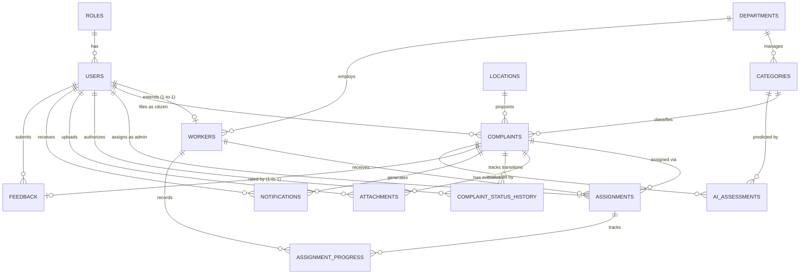

# CivicPulse — Database Schema & Relationships

## Overview

CivicPulse uses **PostgreSQL 18** as its primary relational database. The schema is defined using **SQLAlchemy 2.0 (synchronous)** and version-controlled using **Alembic** migrations.

## Current Status

- **Phase 2 — Database Models & Alembic Migrations** ✅ **COMPLETE**
- **Phase 5 — Worker Assignment & Department Enhancements** ✅ **COMPLETE**

All core tables, foreign keys, check constraints, partial unique indexes, immutable progress logs, and Alembic migrations have been generated, tested, and applied.

---

## Entity-Relationship Diagram

---

## The 13 Core Tables

### 1. `roles`
Stores stable authorization role definitions for Citizens, Administrators, and Field Workers.
- **Primary Key**: `id` (INTEGER, autoincrement)
- **Columns**:
  - `name` (VARCHAR(50), UNIQUE, NOT NULL, INDEXED): `CITIZEN`, `ADMINISTRATOR`, `FIELD_WORKER`.
  - `description` (VARCHAR(255), NULLABLE): Functional permissions summary.
  - `is_active` (BOOLEAN, DEFAULT true, NOT NULL).
  - `created_at`, `updated_at` (TIMESTAMPTZ, NOT NULL).
- **Deletion Policy**: Deletion restricted if users reference the role.

### 2. `users`
Core user identity for citizens, administrators, and field workers.
- **Primary Key**: `id` (UUID, default `uuid.uuid4`)
- **Columns**:
  - `role_id` (INTEGER, FK -> `roles.id`, ON DELETE RESTRICT, NOT NULL, INDEXED).
  - `email` (VARCHAR(255), UNIQUE, NOT NULL, INDEXED).
  - `hashed_password` (VARCHAR(255), NOT NULL): bcrypt hash.
  - `full_name` (VARCHAR(150), NOT NULL).
  - `phone_number` (VARCHAR(20), NULLABLE, INDEXED).
  - `is_active` (BOOLEAN, DEFAULT true, NOT NULL).
  - `is_verified` (BOOLEAN, DEFAULT false, NOT NULL).
  - `created_at`, `updated_at` (TIMESTAMPTZ, NOT NULL).
- **Design Rule**: Single user identity; workers have an extended profile in `workers` without duplicating credentials.

### 3. `departments`
Municipal departments responsible for managing and resolving civic issues.
- **Primary Key**: `id` (INTEGER, autoincrement)
- **Columns**:
  - `name` (VARCHAR(100), UNIQUE, NOT NULL).
  - `code` (VARCHAR(20), UNIQUE, NOT NULL, INDEXED): e.g. `ROADS`, `SANITATION`, `WATER`.
  - `description` (TEXT, NULLABLE).
  - `contact_email` (VARCHAR(255), NULLABLE).
  - `contact_phone` (VARCHAR(20), NULLABLE).
  - `is_active` (BOOLEAN, DEFAULT true, NOT NULL).
  - `created_at`, `updated_at` (TIMESTAMPTZ, NOT NULL).

### 4. `categories`
Civic issue classification types linked to the responsible department.
- **Primary Key**: `id` (INTEGER, autoincrement)
- **Columns**:
  - `department_id` (INTEGER, FK -> `departments.id`, ON DELETE RESTRICT, NOT NULL, INDEXED).
  - `name` (VARCHAR(100), UNIQUE, NOT NULL).
  - `description` (TEXT, NULLABLE).
  - `is_active` (BOOLEAN, DEFAULT true, NOT NULL).
  - `created_at`, `updated_at` (TIMESTAMPTZ, NOT NULL).

### 5. `workers`
Profile extension for resolution technicians and field workers.
- **Primary Key**: `id` (UUID, default `uuid.uuid4`)
- **Columns**:
  - `user_id` (UUID, FK -> `users.id`, ON DELETE CASCADE, UNIQUE, NOT NULL, INDEXED): 1-to-1 with `users`.
  - `department_id` (INTEGER, FK -> `departments.id`, ON DELETE RESTRICT, NOT NULL, INDEXED).
  - `employee_id` (VARCHAR(50), UNIQUE, NOT NULL, INDEXED).
  - `designation` (VARCHAR(100), NULLABLE).
  - `is_available` (BOOLEAN, DEFAULT true, NOT NULL).
  - `employment_status` (VARCHAR(50), DEFAULT 'ACTIVE', NOT NULL).
  - `created_at`, `updated_at` (TIMESTAMPTZ, NOT NULL).

### 6. `locations`
Physical geographic locations where civic issues occur.
- **Primary Key**: `id` (UUID, default `uuid.uuid4`)
- **Columns**:
  - `latitude` (FLOAT, NOT NULL): Range: `[-90.0, 90.0]`.
  - `longitude` (FLOAT, NOT NULL): Range: `[-180.0, 180.0]`.
  - `address_line` (VARCHAR(255), NULLABLE).
  - `area_name` (VARCHAR(100), NULLABLE, INDEXED).
  - `city` (VARCHAR(100), DEFAULT 'Default City', NOT NULL, INDEXED).
  - `pincode` (VARCHAR(20), NULLABLE, INDEXED).
  - `landmark` (VARCHAR(255), NULLABLE).
  - `created_at`, `updated_at` (TIMESTAMPTZ, NOT NULL).
- **Check Constraints**:
  - `chk_location_latitude_range`: `latitude >= -90.0 AND latitude <= 90.0`
  - `chk_location_longitude_range`: `longitude >= -180.0 AND longitude <= 180.0`

### 7. `complaints`
Primary civic issue reports submitted by citizens.
- **Primary Key**: `id` (UUID, default `uuid.uuid4`)
- **Columns**:
  - `complaint_number` (VARCHAR(50), UNIQUE, NOT NULL, INDEXED): e.g. `CP-2026-10001`.
  - `citizen_id` (UUID, FK -> `users.id`, ON DELETE RESTRICT, NOT NULL, INDEXED).
  - `category_id` (INTEGER, FK -> `categories.id`, ON DELETE RESTRICT, NOT NULL, INDEXED).
  - `location_id` (UUID, FK -> `locations.id`, ON DELETE SET NULL, NULLABLE, INDEXED).
  - `title` (VARCHAR(200), NOT NULL).
  - `description` (TEXT, NOT NULL).
  - `status` (VARCHAR(50), DEFAULT 'SUBMITTED', NOT NULL, INDEXED): `SUBMITTED`, `UNDER_REVIEW`, `ASSIGNED`, `IN_PROGRESS`, `RESOLVED_AWAITING_VERIFICATION`, `CLOSED`, `REJECTED`, `DUPLICATE`, `ON_HOLD`, `REOPENED`.
  - `priority` (VARCHAR(20), DEFAULT 'MEDIUM', NOT NULL, INDEXED): `LOW`, `MEDIUM`, `HIGH`, `CRITICAL`.
  - `resolved_at` (TIMESTAMPTZ, NULLABLE).
  - `closed_at` (TIMESTAMPTZ, NULLABLE).
  - `created_at`, `updated_at` (TIMESTAMPTZ, NOT NULL).

### 8. `assignments`
Tracks complaint assignment history to field workers.
- **Primary Key**: `id` (UUID, default `uuid.uuid4`)
- **Columns**:
  - `complaint_id` (UUID, FK -> `complaints.id`, ON DELETE CASCADE, NOT NULL, INDEXED).
  - `worker_id` (UUID, FK -> `workers.id`, ON DELETE RESTRICT, NOT NULL, INDEXED).
  - `assigned_by_id` (UUID, FK -> `users.id`, ON DELETE RESTRICT, NOT NULL, INDEXED).
  - `status` (VARCHAR(30), DEFAULT 'ASSIGNED', NOT NULL, INDEXED): `ASSIGNED`, `IN_PROGRESS`, `COMPLETED`, `REASSIGNED`.
  - `assigned_at` (TIMESTAMPTZ, DEFAULT func.now(), NOT NULL).
  - `accepted_at` (TIMESTAMPTZ, NULLABLE): Recorded when worker accepts the task.
  - `started_at` (TIMESTAMPTZ, NULLABLE): Recorded when worker initiates on-site work.
  - `completed_at` (TIMESTAMPTZ, NULLABLE): Recorded when worker completes remediation.
  - `notes` (TEXT, NULLABLE).
  - `created_at`, `updated_at` (TIMESTAMPTZ, NOT NULL).
- **Partial Unique Index**:
  - `uq_active_assignment_per_complaint`: `UNIQUE (complaint_id) WHERE status IN ('ASSIGNED', 'IN_PROGRESS')`. Enforces at database level that no complaint can have more than one concurrently active worker assignment.

### 8a. `assignment_progress`
Immutable milestone updates, observations, and work logs recorded during assignment remediation.
- **Primary Key**: `id` (UUID, default `uuid.uuid4`)
- **Columns**:
  - `assignment_id` (UUID, FK -> `assignments.id`, ON DELETE CASCADE, NOT NULL, INDEXED).
  - `worker_id` (UUID, FK -> `workers.id`, ON DELETE RESTRICT, NOT NULL, INDEXED).
  - `description` (TEXT, NOT NULL): Description of work performed or milestone achieved.
  - `created_at` (TIMESTAMPTZ, DEFAULT func.now(), NOT NULL).

### 9. `attachments`
Metadata and secure storage paths for uploaded evidence.
- **Primary Key**: `id` (UUID, default `uuid.uuid4`)
- **Columns**:
  - `complaint_id` (UUID, FK -> `complaints.id`, ON DELETE CASCADE, NOT NULL, INDEXED).
  - `uploaded_by_id` (UUID, FK -> `users.id`, ON DELETE RESTRICT, NOT NULL, INDEXED).
  - `attachment_type` (VARCHAR(30), DEFAULT 'COMPLAINT_EVIDENCE', NOT NULL): `COMPLAINT_EVIDENCE`, `RESOLUTION_EVIDENCE`.
  - `file_name` (VARCHAR(255), NOT NULL).
  - `file_path` (VARCHAR(500), NOT NULL): Relative storage path; raw binaries are never stored in DB.
  - `file_size_bytes` (INTEGER, NOT NULL).
  - `mime_type` (VARCHAR(100), NOT NULL).
  - `created_at`, `updated_at` (TIMESTAMPTZ, NOT NULL).

### 10. `complaint_status_history`
Immutable audit log tracking all complaint status transitions.
- **Primary Key**: `id` (UUID, default `uuid.uuid4`)
- **Columns**:
  - `complaint_id` (UUID, FK -> `complaints.id`, ON DELETE CASCADE, NOT NULL, INDEXED).
  - `changed_by_id` (UUID, FK -> `users.id`, ON DELETE RESTRICT, NOT NULL, INDEXED).
  - `previous_status` (VARCHAR(50), NULLABLE).
  - `new_status` (VARCHAR(50), NOT NULL).
  - `remarks` (TEXT, NULLABLE).
  - `created_at` (TIMESTAMPTZ, DEFAULT func.now(), NOT NULL).

### 11. `notifications`
In-app notification records for users.
- **Primary Key**: `id` (UUID, default `uuid.uuid4`)
- **Columns**:
  - `recipient_id` (UUID, FK -> `users.id`, ON DELETE CASCADE, NOT NULL, INDEXED).
  - `complaint_id` (UUID, FK -> `complaints.id`, ON DELETE CASCADE, NULLABLE, INDEXED).
  - `notification_type` (VARCHAR(50), NOT NULL): `STATUS_CHANGE`, `ASSIGNMENT`, `FEEDBACK_RECEIVED`, `RESOLUTION_SUBMITTED`, `COMPLAINT_REOPENED`, `SYSTEM`.
  - `title` (VARCHAR(200), NOT NULL).
  - `message` (TEXT, NOT NULL).
  - `is_read` (BOOLEAN, DEFAULT false, NOT NULL, INDEXED).
  - `read_at` (TIMESTAMPTZ, NULLABLE).
  - `created_at` (TIMESTAMPTZ, DEFAULT func.now(), NOT NULL).

### 12. `feedback`
Post-resolution citizen satisfaction reviews and ratings.
- **Primary Key**: `id` (UUID, default `uuid.uuid4`)
- **Columns**:
  - `complaint_id` (UUID, FK -> `complaints.id`, ON DELETE CASCADE, UNIQUE, NOT NULL, INDEXED): 1-to-1 with `complaints`.
  - `citizen_id` (UUID, FK -> `users.id`, ON DELETE RESTRICT, NOT NULL, INDEXED).
  - `rating` (INTEGER, NOT NULL): 1 to 5 stars.
  - `comments` (TEXT, NULLABLE).
  - `created_at`, `updated_at` (TIMESTAMPTZ, NOT NULL).
- **Check Constraint**:
  - `chk_feedback_rating_range`: `rating >= 1 AND rating <= 5`

### 13. `ai_assessments`
Automated AI/ML predictions, category suggestions, and severity recommendations.
- **Primary Key**: `id` (UUID, default `uuid.uuid4`)
- **Columns**:
  - `complaint_id` (UUID, FK -> `complaints.id`, ON DELETE CASCADE, NOT NULL, INDEXED).
  - `assessment_type` (VARCHAR(50), NOT NULL, INDEXED): e.g. `CATEGORY_PREDICTION`, `SEVERITY_PREDICTION`, `DUPLICATE_DETECTION`.
  - `predicted_category_id` (INTEGER, FK -> `categories.id`, ON DELETE SET NULL, NULLABLE).
  - `predicted_priority` (VARCHAR(20), NULLABLE).
  - `confidence_score` (FLOAT, NULLABLE): Range: `[0.0, 1.0]`.
  - `explanation` (TEXT, NULLABLE).
  - `model_version` (VARCHAR(50), NOT NULL).
  - `raw_response` (JSON, NULLABLE).
  - `created_at` (TIMESTAMPTZ, DEFAULT func.now(), NOT NULL).
- **Check Constraint**:
  - `chk_ai_confidence_range`: `confidence_score IS NULL OR (confidence_score >= 0.0 AND confidence_score <= 1.0)`

---

## Database Sequences

### `complaint_number_seq`
PostgreSQL sequence used for atomic, collision-free human-readable complaint reference numbers.
- **Start Value**: 10001
- **Increment**: 1
- **Cache**: 1
- **Generated Format**: `CP-{YYYY}-{seq_val:05d}` (e.g. `CP-2026-10001`)

---

## Migration History

| Revision | Description | Target | Verification Status |
|---|---|---|---|
| `dc808166f213` | `001_initial_schema` — Creates all 13 core tables, indexes, and constraints | `dc808166f213` | ✅ Verified against `civicpulse_test` and applied to `civicpulse`. |
| `5c60c8914494` | `002_seed_initial_roles` — Seeds `CITIZEN`, `ADMINISTRATOR`, `FIELD_WORKER` | `5c60c8914494` | ✅ Idempotent data migration verified on dev and test databases. |
| `7f3a8b2c4d1e` | `003_seed_departments_categories_and_seq` — Creates `complaint_number_seq` and seeds 5 departments and 7 categories | `7f3a8b2c4d1e` | ✅ Verified against `civicpulse_test` (upgrade + downgrade + re-upgrade) and applied to `civicpulse`. |
| `8d2e4f6a1c3b` | `004_assignment_enhancements_and_progress` — Adds `accepted_at`, `started_at`, partial unique index `uq_active_assignment_per_complaint`, and `assignment_progress` table | `head` | ✅ Verified against `civicpulse_test` (full downgrade + upgrade cycle) and applied to `civicpulse`. |

---

## Database Design Conventions

1. **UUID Primary Keys**: Major business entities (`users`, `workers`, `complaints`, `assignments`, `locations`, `attachments`, `complaint_status_history`, `notifications`, `feedback`, `ai_assessments`) use UUID v4. Lookup tables (`roles`, `departments`, `categories`) use auto-incrementing integers.
2. **Timestamps**: All timestamps use PostgreSQL `TIMESTAMPTZ` with UTC storage (`DateTime(timezone=True)`).
3. **Foreign Key Integrity**:
   - Deletion of parent complaint cascades to child artifacts (`attachments`, `assignments`, `status_history`, `feedback`, `notifications`, `ai_assessments`).
   - Deletion of users or categories referenced by complaints is restricted (`RESTRICT`) to preserve historical audit integrity.
4. **No Binary in DB**: Attachments store relative filesystem paths (`uploads/...`), never raw byte blobs.
5. **Check Constraints**: Enforced at the database level for coordinates (`[-90, 90]`, `[-180, 180]`), ratings (`1..5`), and confidence scores (`0.0..1.0`).
